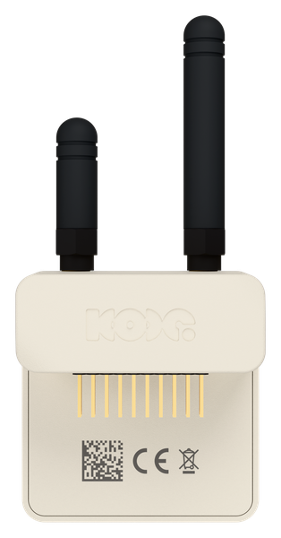

<div align="center" markdown="1">



# kode-mesh-sdk

**The SDK for the Mesh module of the Kode Dot: LoRa on 868 MHz and 2.4 GHz and GNSS from an app, in C**

[](https://github.com/espressif/esp-idf)


[Documentation](https://docs.kode.diy/modules/mesh) ·
[Quick start](#quick-start) ·
[Examples](#examples) ·
[kode-sdk](https://github.com/kodediy/kode-sdk)

</div>

---

The Mesh (KDMSH001) is a radio module for the **Kode Dot**. It plugs into the expansion header and carries a Semtech LR2021 LoRa transceiver, with an amplifier and an SMA connector for each band (sub-GHz and 2.4 GHz), and a GNSS receiver. This SDK sits next to [kode-sdk](https://github.com/kodediy/kode-sdk): an app adds one dependency and calls `mesh_radio_begin()`, `mesh_radio_send()` or `mesh_gnss_fix()`, and does not need to know the commands of the chip, the limits of the band or the duty cycle.

- **One owner for the module.** One Active Object finds the module, sets it up and holds it; your code asks it and never touches a chip. It notices when the module is pulled out and when it comes back.
- **Two layers, as in kode-sdk.** `mesh.h` has calls that wait, for `app_main()` and your tasks: each answers `true` or `false`, and `mesh_error()` says why. `mesh_sys.h` has calls that never wait, for an Active Object of your own.
- **Nothing transmits by itself.** Only a send that your code asks for goes on air, and the SDK holds it to the band, the power and, on 868 MHz, the duty cycle in `mesh_region.h`. 868 MHz is a European band; check your country's rules before transmitting.

```c
#include "kode.h"
#include "mesh.h"

void app_main(void)
{
    mesh_status_t st;

    kode_init();                                   /* start the board */
    mesh_begin();                                  /* take the header, look for the module */
    if (mesh_wait_present(10000) && mesh_status(&st)) {
        kode_print("a Mesh is on the header");     /* nothing here transmits */
    } else {
        kode_print("no module: %s", mesh_error());
    }
    kode_exit();                                   /* back to kodeOS */
}
```

## Quick start

You need a Kode Dot running kodeOS, a Mesh module on its expansion header and [ESP-IDF v6.1](https://docs.espressif.com/projects/esp-idf/en/v6.1/esp32p4/get-started/).

```bash
. <path-to-esp-idf>/export.sh
idf.py -C examples/module build
idf.py -C examples/module -p PORT flash
```

The first build prints one CMake error while it fetches the board settings, `kbsp: the partition table has no apps region (data, 0x40), so this app has nowhere to be installed`, and goes on by itself. `flash` writes the app to the board's mailbox; kodeOS installs it and starts it. The log says when the module is found and, every five seconds, what the SDK knows of it. Pull the module out and the log says so. A short press of the bottom button goes back to kodeOS. This example transmits nothing and needs no antenna.

To start an app of your own, copy the example closest to it.

## Examples

| | |
|---|---|
| `module` | the module found on the header, and what the SDK knows of it. Run it first |
| `gnss` | the GNSS receiver on, and what it reports every two seconds |
| `receive` | the receiver on 868 MHz, and every packet on the log |
| `send` | one short packet a minute on 868 MHz. **Transmits** after its top button: an antenna or a 50 ohm load on the sub-GHz connector first |
| `console_actions` | the module on kodeOS's console. **Transmits** only when asked from the console, after `mesh_tx_arm` is given 1 |

`module` and `gnss` are tasks (`mesh.h`); the other three are Active Objects (`mesh_sys.h`). No example transmits without a keypress or a typed row.

## Use it in your project

```yaml
# main/idf_component.yml
dependencies:
  kodediy/kode:
    git: https://github.com/kodediy/kode-sdk.git
    path: components/kode
    version: v0.1.5
  kodediy/mesh:
    git: https://github.com/kodediy/kode-mesh-sdk.git
    path: components/mesh
    version: v0.1.0
```

Add `mesh` to your component's `REQUIRES`; it brings `mesh_sys.h` with it. Copy `CMakeLists.txt` and `sdkconfig.defaults` from an example: they fetch the Dot's settings from kode-sdk, and they set `CONFIG_KODEOS_RADIO=y`, which lets the SDK switch the module's supply.

## Not run on a module yet

With this release the module was found, the radio was begun and received on both bands, and the GNSS streamed NMEA. Transmitting has not been run on a module with it.

## Documentation

Everything else is at **[docs.kode.diy/modules/mesh](https://docs.kode.diy/modules/mesh)**. In this repository, [the overview](docs/overview.md) says what the SDK drives, how it works, what surprises, the options, the console, what it costs an app and the layout of the tree. The two headers, `mesh.h` and `mesh_sys.h`, are the contract. Each component and each example also has a short README.

## Contributing

Bugs, ideas and pull requests are welcome; the SDK's maintainer reviews and approves every change. Pull requests go to `develop`, and `main` holds the releases. Read [CONTRIBUTING.md](https://github.com/kodediy/.github/blob/main/CONTRIBUTING.md) first; the checks a change must pass are `tools/host_tests.sh`, `tools/check_layers.sh`, `tools/check_example_pins.sh` and `idf.py -C tests/target build`, run on your machine.

## Licence

[GPL-3.0-or-later](LICENSE), as kode-sdk. [NOTICE.md](NOTICE.md) says which licence applies where.
